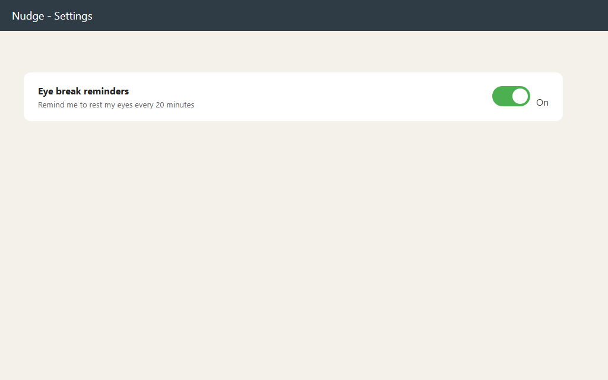
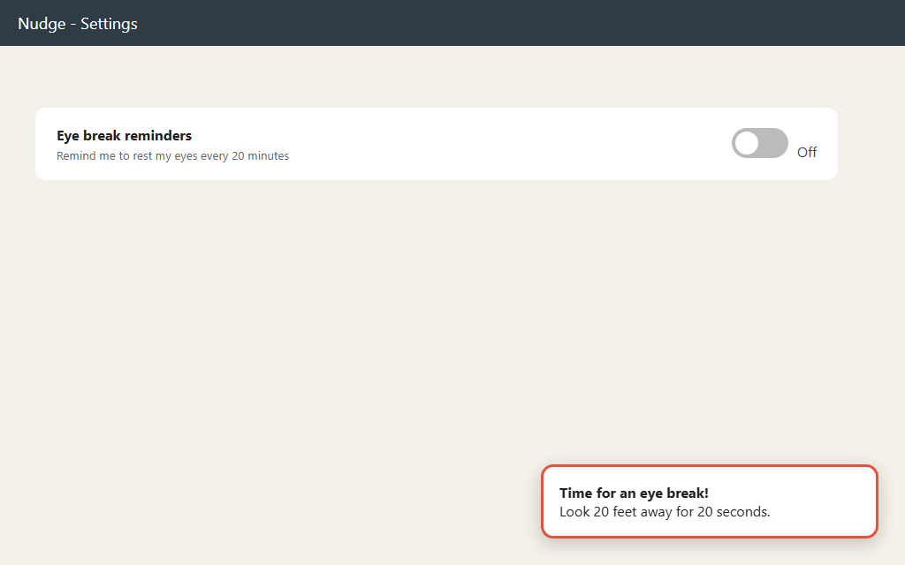
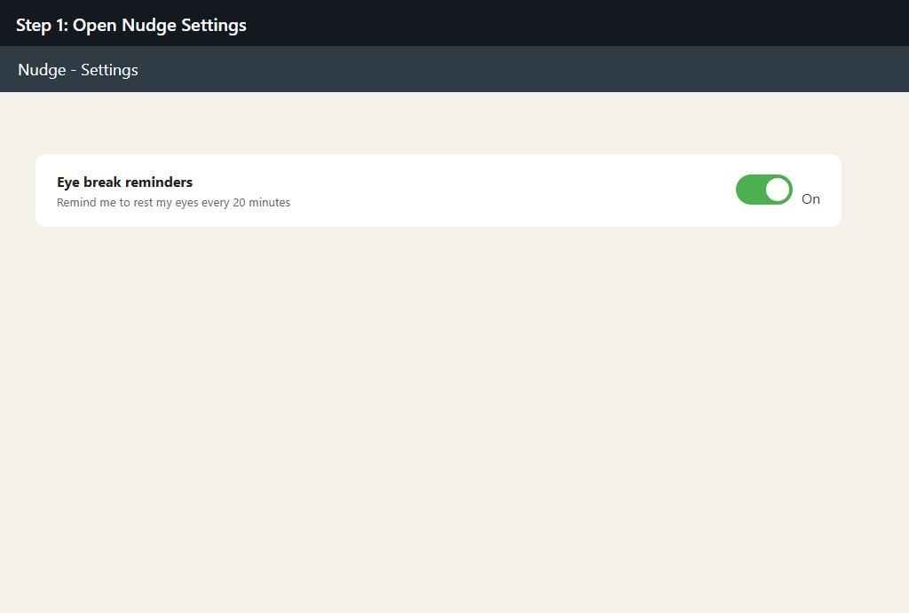

# File GitHub Issue

**Report a problem in your own words. Get a clear, professional GitHub issue, with pictures.**

This is a "skill" for Claude, the AI assistant. A skill teaches Claude how to do one job really well. This one teaches Claude to write up and file issues on GitHub (the place where software teams keep track of bugs and to-dos) in plain, simple language that anyone on your team can understand.

You don't need to know how to write a bug report. Just tell Claude what happened, like you would tell a friend:

> "When I turn off eye-break reminders in Settings, the reminder still pops up. File the issue in our GitHub."

Claude does the rest.

---

## What it does for you

1. **Asks a couple of simple questions** if anything is missing, such as which project it's for.
2. **Works out what kind of issue it is**: a **Bug** (something is broken), a **Feature** (something new or better is wanted) or a **Task** (a job that needs doing).
3. **Writes the issue** in plain words, with clear numbered steps.
4. **Takes the pictures for you.** If the problem is on a website, Claude opens it, follows the steps itself and captures:
   - a **Before** and **After** screenshot, side by side
   - a short **step-by-step animation** that plays right inside the issue
   - a full **video** of what happened
5. **Shows you a preview** so you can check and change anything.
6. **Files it on GitHub** only when you say it looks good, and gives you the link.

---

## What a finished issue looks like

Every issue has the same easy-to-read sections:

| Section | What it says |
|---|---|
| **Type** | Bug, Feature or Task |
| **Title** | The problem in one short line |
| **Description** | What's wrong, in one to three sentences |
| **Pre-condition** | Anything that needs to be set up first (or "None") |
| **Steps to Reproduce** | Numbered steps anyone can follow to see the problem |
| **Actual Result** | What really happens |
| **Expected Result** | What should happen instead |
| **Evidence** | Before/After pictures, a step-by-step animation and a video |

Here is the Evidence section from a real test issue:

| Before: reminders switch is **On** | After: switch is **Off**, but the pop-up still appears |
|---|---|
|  |  |

**Step by step** (in the issue, this plays like a short video):



Each step has a caption on top, and whatever is being clicked is outlined in red, so anyone can follow along.

---

## Where your pictures and videos are kept

**All evidence is stored in a gist on your own GitHub account.** A gist is a small storage space that comes free with every GitHub account.

- Nothing is sent to any outside website or company.
- The pictures belong to you, and you can delete them at any time at [gist.github.com](https://gist.github.com).
- The gists are **"secret"**, which means they don't show up in searches or on your profile. Anyone who has the exact link can still open them, though. Claude reminds you of this before uploading anything, so you can blur or crop private details first.

---

## What you need

| You need | What it is | Where to get it |
|---|---|---|
| **Claude Code** | The Claude app that can work on your computer | [claude.com/claude-code](https://claude.com/claude-code) |
| **A GitHub account** | Where your issues and pictures are kept | [github.com](https://github.com) |
| **Git** | A free tool Claude uses to upload the pictures (on Windows this also includes "Git Bash") | [git-scm.com](https://git-scm.com) |
| **GitHub CLI** | A free tool that lets Claude use your GitHub account | [cli.github.com](https://cli.github.com) |
| **Node.js** *(optional)* | Only needed if you want Claude to take the screenshots itself | [nodejs.org](https://nodejs.org) (choose "LTS") |

After installing the GitHub CLI, connect it to your account once. Open a terminal (on Windows: **Git Bash**; on Mac: **Terminal**) and type:

```bash
gh auth login
gh auth refresh -s gist
```

Follow the instructions on screen. The second line gives permission to save pictures in your gists.

> The first time Claude takes screenshots itself, it downloads a small browser for the job (about 150 MB). This only happens once.

---

## How to install

### The easy way (one line)

Open Claude Code, type this line and press Enter:

```
/plugin install file-github-issue --marketplace subin-shk/file-github-issue
```

That's it. Claude now knows the skill.

**That didn't work?** You may have an older version of Claude Code. Use these two lines instead, one at a time:

```
/plugin marketplace add subin-shk/file-github-issue
/plugin install file-github-issue@subin-shk
```

### Or copy it by hand

1. Download this project: click the green **Code** button at the top of this page, then **Download ZIP**, and unzip it.
2. Open the **`skills`** folder inside it and find the folder called **`file-github-issue`**.
3. Copy that folder into your Claude skills folder:
   - **Windows:** `C:\Users\<your name>\.claude\skills\`
   - **Mac / Linux:** `~/.claude/skills/`

   If the `skills` folder doesn't exist yet, create it.
4. Restart Claude Code.

---

## How to use it

Just talk to Claude normally. The skill starts on its own when you say things like:

- "**File the issue** in GitHub"
- "**Log this bug** in acme/shop"
- "**Open an issue** for this"
- "**Add a feature request**: customers want a wishlist"
- "**Create a task** to update the help page screenshots"

You can also start it directly: type **`/`** in Claude Code and choose **file-github-issue** from the list.

If you've already been chatting with Claude about a problem, just say **"file the issue"**. Claude uses what you discussed and only asks about anything missing.

**More examples:**

- "The checkout page on http://localhost:3000 freezes when I apply a coupon. Log a bug in acme/shop and capture before and after."
- "File the issue in acme/app. The desktop app crashes when I export. My recording is at `C:\Users\me\Videos\crash.mp4`."
- "Customers say they never get the password reset email. Turn this into a GitHub issue."

**Problem in a desktop or phone app?** Claude can't open those itself, so it tells you exactly how to take a screenshot or record your screen on Windows, Mac or your phone, then uses your files.

---

## Is it safe?

- **Nothing is filed without your OK.** You always see a preview first.
- **Claude doesn't click anything risky on a live website**, such as buying, deleting or sending emails, without asking you first.
- **Passwords are never written into the issue** or saved in any file.
- **Your pictures stay in your own GitHub account**, in a gist.

---

## If something goes wrong

| What you see | What to do |
|---|---|
| "The GitHub CLI (gh) is not installed" | Install it from [cli.github.com](https://cli.github.com) |
| "Not logged in to GitHub" | Open a terminal and type `gh auth login` |
| A message about "scopes" or "gist" permission | Open a terminal and type `gh auth refresh -s gist` |
| "Node.js is not installed" | Install it from [nodejs.org](https://nodejs.org), or give Claude your own screenshots instead |
| "File is larger than 100 MB" | Make the video shorter or smaller, then try again |
| A picture doesn't show right after uploading | Wait a minute and refresh. GitHub can take a moment |
| The video link downloads instead of playing | This is normal in some browsers. Open the downloaded file, or watch the animation in the issue |

---

## What's in this project

```
skills/
└── file-github-issue/              ← the skill (this is the folder you copy)
    ├── SKILL.md                    ← instructions Claude follows
    └── scripts/
        ├── upload_evidence.sh      ← saves pictures and videos to your gist
        ├── setup_capture.sh        ← one-time setup for taking screenshots
        └── capture_template.mjs    ← takes the before/after pictures, animation and video
.claude-plugin/                     ← lets Claude Code install it with one line
docs/                               ← example pictures used on this page
LICENSE                             ← MIT: free for anyone to use, change and share
```

---

## License

Free to use, change and share under the [MIT License](LICENSE).
